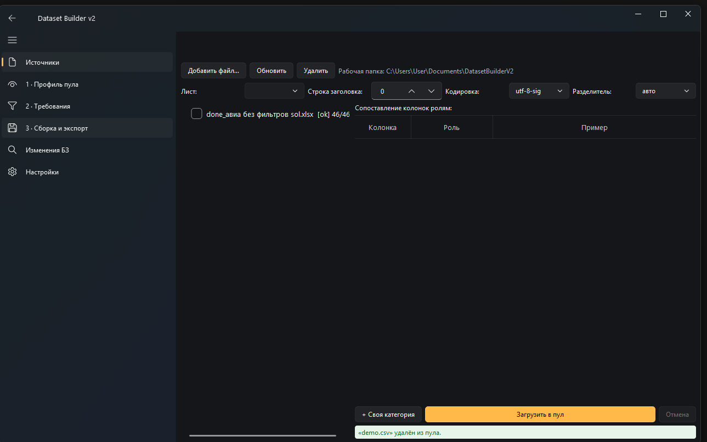
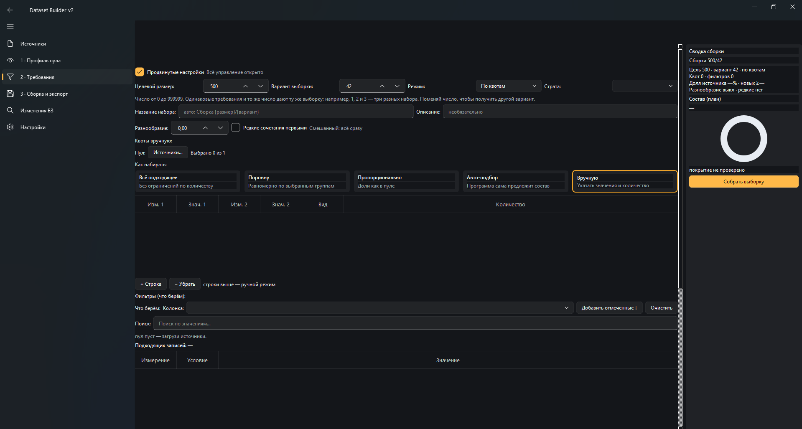
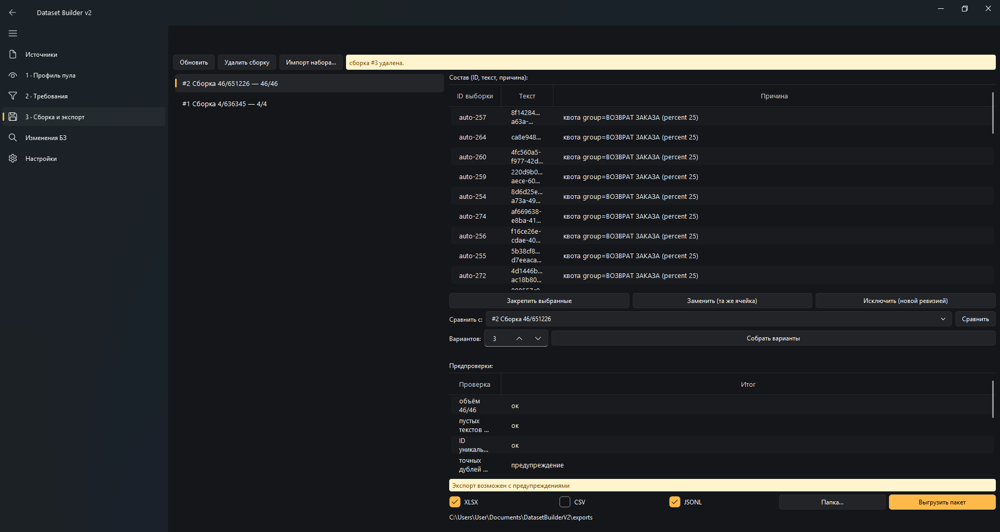

# Dataset Builder

Десктоп-программа для AI-тренера: собрать из сырого пула записей правильную,
воспроизводимую выборку для обучения — и выгрузить её пакетом.

Готовую сборку под Windows без установки Python забирай на странице
[Releases](https://github.com/Rhun96/Dataset-Builder/releases): распакуй zip
и запусти `DatasetBuilderV2.exe`.

Все данные хранятся только локально: загруженные файлы копируются в рабочую
базу (`Документы\DatasetBuilderV2\workspace.sqlite`), сеть не используется.

## Зачем

- У тебя есть пул: выгрузки диалогов, обращения, отзывы (XLSX, CSV, JSON, JSONL, ODS).
- Нужно: взять N записей с заданным составом (например, поровну по категориям),
  без дублей и с учётом редких случаев.
- Получить: набор + манифест + отчёт о покрытии. Всё локально, без сети.

## Как это работает

1. **Источники** — добавь файлы, укажи, какая колонка что значит
   (текст, категория, тема, ID...), загрузи в пул.
2. **Профиль пула** — посмотри, что у тебя в данных: распределения,
   заполненность, дубликаты, редкие значения.
3. **Требования** — задай размер, выбери режим («Всё подходящее», «Поровну»,
   «Пропорционально», «Авто-подбор», «Вручную»), фильтры и квоты.
   Покрытие считается сразу, с подсветкой дефицита.
4. **Сборка и экспорт** — собери выборку, проверь предпроверки,
   выгрузи пакет: XLSX / CSV / JSONL + manifest + отчёт.

Каждая сборка воспроизводима: тот же размер и «вариант выборки» дают тот же набор.
Сборки иммутабельны — правки делаются новой ревизией, а не задним числом.

## Быстрый старт (2 минуты)

1. Запусти `run_app.bat` (или распакованный `DatasetBuilderV2.exe` из Releases).
2. Вкладка **Источники** → «Добавить файл» → выбери `demo_data/demo.csv` из папки проекта.
   Роли колонок подставятся сами — нажми «Загрузить в пул».
3. Вкладка **2 · Требования** → выбери «Всё подходящее» (размер подгонится сам).
4. Нажми «Собрать выборку».
5. Вкладка **3 · Сборка и экспорт** → «Выгрузить пакет». Готово: набор + manifest + отчёт.

Второй заход: в Требованиях выбери «Поровну», укажи колонку с категориями —
получишь сбалансированную выборку.

## Скриншоты





## Если что-то пошло не так

**Красное «мало пригодных» / «ДЕФИЦИТ».** Записей под условия меньше, чем цель.
Варианты: уменьши целевой размер, ослабь фильтры, выбери «Всё подходящее»
(размер подгонится под доступное) или догрузи ещё файлов в пул.

**«Пул пуст».** Ни один источник не включён: открой «Источники», загрузи файл
и проверь галочки слева в списке.

**Как исключить уже использованные записи.** В Требованиях (продвинутые настройки)
отметь прошлые сборки в «Исключить сборки» — новые выборки их не повторят.
Нужно наоборот сохранить часть старого состава — «Сохранить из» + «минимум».

**Нужен другой вариант того же набора.** Поменяй «Вариант выборки»
(например, с 42 на 43) и собери заново — состав перемешается.

## Возможности

- 5 форматов входа, потоковое чтение больших файлов (проверено на 100k записей).
- Квоты: точные, минимумы, проценты, комбинированные («категория × тема»).
- Новизна: исключить прошлые сборки, требовать минимум новых записей.
- Разнообразие (не брать near-дубликаты) и приоритет редким сочетаниям.
- Сохранённые именованные профили требований.
- Diff базы знаний: что изменилось между версиями, какие кейсы перепроверить.
- Тёмная / светлая / системная тема, русский интерфейс.

## Запуск из исходников

Нужен Python 3.11+:

```bat
run_app.bat      — запуск программы
start.bat        — самопроверка (тесты + демо-разведка)
```

Проверка кода: `py -3 -m pytest -q`, `py -3 -m ruff check .`.
